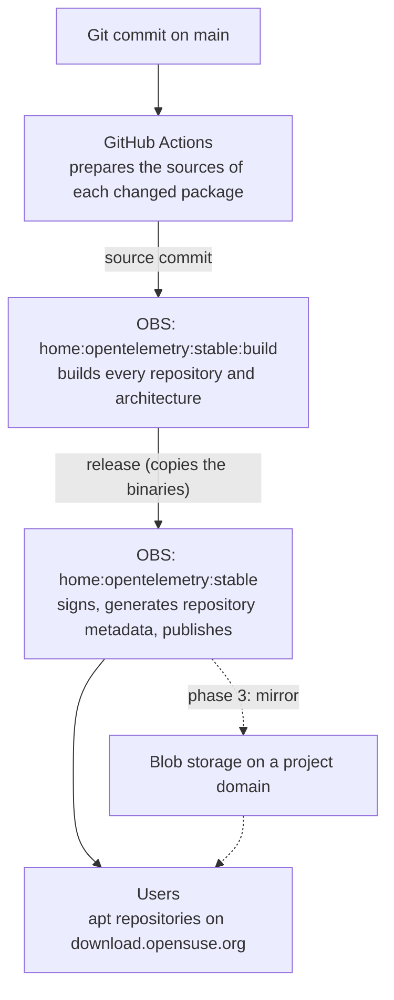

# Package building and publishing

## Status

Proposed

## Context

The system packages need to reach users as signed DEB and RPM repositories that `apt` and `dnf` can install from and upgrade against.
Today the Debian and Ubuntu packages come from nfpm (`make deb-packages`) and never pass through a build service, so nothing signs them or generates repository metadata for them.
The Fedora and EPEL RPMs build in [Fedora COPR](https://copr.fedorainfracloud.org/coprs/opentelemetry/opentelemetry-packaging/), which signs them and serves a repository.
COPR, however, only builds RPMs, and it builds every component at once from a release tag.

The packages also release at different paces.
Each one bundles an upstream agent (the injector, or the Java, Node.js, .NET, or Python auto-instrumentation) that ships on its own schedule.
A new Java agent should reach users without rebuilding or re-releasing the other packages.

This document describes how the packages are built, versioned, signed, and published, and what the CI pipeline does.

### Scope

The work is split into phases.

1. **DEBs on OBS.** Build and publish the Debian and Ubuntu packages on the openSUSE Open Build Service (OBS).
   Users install them from the repositories OBS publishes.
   COPR keeps building the RPMs, unchanged, in the meantime.
2. **RPMs on OBS.** Once the DEB path is in place, build the Fedora and EPEL packages on OBS with the same model, and retire COPR.
   This document covers that phase only in outline; its details are added when it starts.
3. **Blob storage mirror.** Mirror the published repositories to blob storage behind a project domain.
   Its provider, domain, and trigger are not decided yet.

### Goals

- Build the DEB packages, and then the RPMs, on a single hosted build service that signs them and generates repository metadata.
- Release each package on its own, when its upstream agent or its packaging changes.
- Keep previously released versions installable.
- Later, serve the repositories from storage and a domain the project controls, so the build service can change without users reconfiguring their systems.

### Non-goals

- Running our own build service instance.
- Nightly or development channels.
- Changing how COPR builds the RPMs before it is retired.
- Changing how the GitHub release assets are versioned.

## Open Build Service

[OBS](https://build.opensuse.org) is a hosted build farm run by openSUSE.
Like COPR, it builds packages, signs them, and publishes them as repositories.
Unlike COPR, it builds for many distributions, including Debian and Ubuntu, so a single service can cover every target.

### Vocabulary

OBS gives common words specific meanings, and this document uses them in the OBS sense.
A **project** (for example `home:opentelemetry:stable`) is a namespace that holds packages, build settings, and a signing key; projects nest with `:`.
An OBS **package** is a directory of source files inside a project, from which OBS builds one or more binary `.deb` files.
An OBS **repository** is a build target inside a project: a base distribution plus a list of architectures.
When a project publishes, each of its repositories becomes an apt repository that users can add.

A **source commit** stores a new set of files in an OBS package and creates a new **source revision**, much like a Git commit.
OBS then builds that revision for every repository and architecture of the project.
"Git commit" in this document always means a commit in this GitHub repository, and "source revision" always means the OBS one.

## Overview

CI prepares the complete contents of each package and the recipe to assemble them, and uploads both to OBS.
OBS compiles nothing: it assembles the prepared contents into DEBs with [`debbuild`](https://github.com/debbuild/debbuild), a tool that builds DEBs from an RPM-style spec.
Once every build has succeeded, CI asks OBS to release the package, and OBS copies the binaries into the project users install from.



In phase 3, a mirror copies the published repositories to blob storage on a project domain, and that address replaces `download.opensuse.org` for users.
See [Blob storage mirror](#blob-storage-mirror).

| Concern | Owner |
| --- | --- |
| Choosing what to build, preparing the package contents, generating sources | GitHub Actions, from this repository |
| Building the binary packages | OBS |
| Signing packages and repository metadata | OBS, with a key it generates and holds |
| Generating repository metadata (`Packages`, `Release`, `InRelease`) | OBS |
| Retaining released versions | OBS (`home:opentelemetry:stable`) |
| Serving users | OBS at first, a blob storage mirror on a project domain from phase 3 |

OBS generates the signing key and keeps it on its signing server, and no private key is ever downloaded, uploaded, or handled by the project.
Subprojects inherit the key of `home:opentelemetry`, and users fetch the public key from the published repository.

## OBS setup

### Project layout

```text
home:opentelemetry                 owns the signing key; no packages, no repositories
├── :sandbox                       disposable; trying changes before they reach users
└── :stable                        what users install: published, builds disabled, keeps old versions
    └── :build                     CI commits here; a release copies the results into :stable
```

CI commits sources to `home:opentelemetry:stable:build`, which builds them but publishes nothing.
After the builds succeed, CI asks OBS to release the package, and OBS copies its binaries into `home:opentelemetry:stable`.
Each release lands there as a separate entry named `<package>.<timestamp>`, so earlier versions stay in the published repository.

In OBS terms, each repository of the build project has a release target pointing at `home:opentelemetry:stable`, triggered manually, which is what the release request uses.
`home:opentelemetry:stable` is a maintenance release project, the OBS project kind that keeps every release instead of replacing the previous one.
`home:opentelemetry:sandbox` is a separate project for trying changes, and it never releases.

### Repositories and targets

The stable build project has 2 repositories, both for `x86_64` and `aarch64`.

| Repository | Built against | Serves |
| --- | --- | --- |
| `debian` | Debian 12 | Debian 12 and newer |
| `ubuntu` | Ubuntu 22.04 | Ubuntu 22.04 and newer |

The package contents do not depend on the release they are built against, so packages built against these baselines are expected to install on newer releases of the same distribution.
So far this has been tested on Debian 12 and 13, and on Ubuntu 22.04, 24.04, and 26.04.
Debian and Ubuntu get separate repositories, so a difference between them can be handled when one appears.

The sandbox instead has a repository per release (Debian 12 and 13, Ubuntu 22.04, 24.04, and 26.04), each for both architectures.
That makes it possible to compare the same package across releases before it reaches users.

### Packages

Each component is a separate OBS package with its own sources: `opentelemetry-injector`, the 4 `opentelemetry-*-autoinstrumentation` packages, and the `opentelemetry` metapackage.
The packages have no build dependencies on each other, so committing to one rebuilds only that one.
They depend on each other only through unversioned virtual names (see [Linux system packages meta architecture](packages-meta-architecture.md)), so packages at different versions install together.
The `opentelemetry-jmx-scraper` package from that document is not implemented yet; it becomes another OBS package once it is.

### Sources

Nothing is compiled on OBS.
Its build roots have no network access, so a build could not fetch the upstream agents.
Debian 12 also cannot supply the Go version this repository needs, so a build could not compile the tools either.

Instead, CI prepares everything a build needs, as Kubernetes does (see [Prior art](#prior-art)).
For each package, `make deb-sources` (or `make deb-sources-<component>`) writes the 2 files that make up its OBS sources.

- `<package>-<version>.tar.gz` holds the prepared package contents for every architecture, a directory per architecture, plus the file lists.
  It is prepared with the same code as the nfpm packages, so the contents cannot drift between the two.
- `<package>.spec` is the packaging recipe, rendered from the same component metadata.
  It has no build step: its install step only copies the directory for the build architecture.

OBS builds the spec with `debbuild`.
This keeps a single spec format for DEB and RPM instead of a separate `debian/` tree.

## Versioning

This scheme applies to the packages on OBS only.
The GitHub release assets, and COPR until it is retired, keep the repository release tag version.

A package version has the form `<component version>-<package release>`.
The component version says which agent the package ships, and the package release says which packaging of that agent it is.

### Component version

The component version is the version of the agent the package ships.
It is read from the checked-out tree, never from a workflow input, so building the same Git commit always gives the same component version.

| Package | Version source |
| --- | --- |
| injector, Java, Node.js, .NET | `packaging/common/<component>/release.txt`, bumped by Renovate |
| Python | the `opentelemetry-distro` pin in `packaging/common/python/requirements.txt`, bumped by Renovate |
| metapackage | `packaging/common/meta/release.txt`, bumped by hand |

The metapackage declares its relations without versions and ships only a README, so it does not change when another package does.
Its version is bumped by hand when its relations or contents change, for example when a new package joins the suite.

### Package release

The package release changes whenever the packaging changes for the same component version, for example its paths, dependencies, or lifecycle scripts.
OBS manages it, so this repository neither stores nor bumps it.

OBS sets the release to `<commits>.<builds>`.
`<commits>` counts the source commits at the current component version, and restarts at 1 when the version changes.
`<builds>` counts rebuilds of the same source revision, which OBS starts on its own, for example after an update to the base distribution.

| Event | Version in the build project | Version users get |
| --- | --- | --- |
| `1.0.0`, first upload | `1.0.0-1.1` | `1.0.0-1.1` |
| Same version, identical sources | stays `1.0.0-1.1`, nothing is committed | `1.0.0-1.1` |
| OBS rebuilds the same source revision | `1.0.0-1.2` | stays `1.0.0-1.1` |
| Same version, packaging changed | `1.0.0-2.1` | `1.0.0-2.1` |
| Next version, `1.1.0` | `1.1.0-1.1` | `1.1.0-1.1` |

A rebuild OBS starts on its own stays in the build project, because releases happen only when CI requests them.
The next push sees that package's sources as unchanged and skips it.
To publish such a rebuild, a maintainer dispatches the workflow for that package with `release_unchanged=true`; otherwise it is superseded by the next source change.

### Reproducible sources

The release counter only stays meaningful if CI makes a source commit only when the sources really changed.
CI therefore dates each package by its **source date**: the time of the last Git commit that touched that package's inputs, passed to the generator as [`SOURCE_DATE_EPOCH`](https://reproducible-builds.org/specs/source-date-epoch/).
The archive entries are sorted, owned by root, and dated with the source date, and so are the man pages.

An unchanged package therefore regenerates byte-identical sources.
CI compares their file names and MD5 sums with the sources stored on OBS, and skips the upload when they match.

## Rebuild triggers

Changes to the paths below select packages on a push to `main`.
CI uploads, rebuilds, and releases a selected package only when its generated sources differ from those on OBS.

| Change | Selects |
| --- | --- |
| Anything under `packaging/common/<component>/`, such as a `release.txt` bump | that component |
| Shared packaging code, lifecycle scripts, the tools built into packages, or build configuration | every component |
| The workflow, the tools that plan and upload, or documentation | nothing |

The shared inputs are `packaging/builder/`, `packaging/common/scripts/`, `cmd/build-spec/deb/`, `cmd/otel-config-check/`, `NOTICE`, `Makefile`, `go.mod`, and `go.sum`.
The planning and upload tools (`cmd/package-metadata`, `cmd/obs-publish`) are not inputs, because they change how sources are uploaded, not what is in them.
The change-detection rules are implemented in `packaging/changes`.

A typical update is a Renovate PR that bumps the pin of a single agent.
Once it merges, only that package is rebuilt, gets the new component version with release `1.1`, and is released.
A builder change selects every package: those whose regenerated sources are unchanged are skipped, and the others get a new release counter at the same component version.

The workflow can also be dispatched by hand: for the first upload, for a single package, for another Git ref, or to try a change in the sandbox.
See [Dispatch inputs](#dispatch-inputs).

## CI pipeline

The `Build on OBS` workflow (`.github/workflows/obs.yml`) runs on every push to `main` of the official repository, and on manual dispatch.
It has a `plan` job that decides what to build, and a `publish` job that runs once per selected package.

### Dispatch inputs

| Input | Default | Purpose |
| --- | --- | --- |
| `ref` | the Git commit the run is on | Git branch, tag, or commit to build |
| `packages` | `all` | `all`, or a comma-separated list of components |
| `project` | `stable` | where to build; see the table below |
| `release` | `true` | `false` stops once the build project has built the packages |
| `release_unchanged` | `false` | also release packages whose sources are already on OBS |

| `project` | Commits sources to | Releases to |
| --- | --- | --- |
| `stable` | `home:opentelemetry:stable:build` | `home:opentelemetry:stable`, unless `release=false` |
| `sandbox` | `home:opentelemetry:sandbox` | nothing |

With `release=false`, the sources stay committed and built in `home:opentelemetry:stable:build`, and nothing is published.
A later dispatch with `release_unchanged=true` releases them.
Runs in forks always use the sandbox, whatever the input says.

### Plan

The `plan` job checks out the Git ref with its full history and runs `cmd/package-metadata -target obs -plan`.
On a push, it lists the files changed between the commit `main` pointed to before the push and the pushed commit, and selects packages with the rules above.
If the earlier commit is not in the history, as after a force-push, it selects every package.
On a dispatch, it takes the `packages` input instead.

For each selected package, the job outputs the component, the OBS package name, the component version, and the source date.
It also resolves the OBS project and whether to release, as in the tables above.

### Publish

The `publish` job runs once per selected package, in parallel, and a failing package does not stop the others.
Runs for the same package and project are serialized, and a run in progress is never cancelled, so a source commit and its release do not interleave with those of another run.
A run that is still waiting to start is superseded when a later one reaches the same package.
On a push that is the intended behaviour, because the later run regenerates the sources from a tree that already contains the commit of the superseded run.
A dispatch that is waiting to start is superseded in the same way, so a release requested by hand while another run holds the package has to be dispatched again.

For each package, it:

1. Generates the sources with the planned source date.
2. Compares them with the sources of the package on OBS, and creates the package if it does not exist yet.
   If they are identical, it stops, unless `release_unchanged=true`, in which case it skips to step 4 with the current source revision.
3. Makes a source commit to the build project, creating a new source revision.
   Files OBS holds that are not in the new set, such as the archive of the previous version, are removed.
4. Waits until that source revision has built in every repository and architecture.
5. Requests a release to `home:opentelemetry:stable`, only if every build succeeded and releasing is enabled for this run.

The wait in step 4 checks the last finished build job of each repository and architecture against the source revision, so the results of the previous revision are never mistaken for this one.
It fails at once on `excluded`, which means OBS will not build the package for that target at all.
It also fails on `failed` (the build ran and failed), `broken` (OBS cannot process the sources), or `unresolvable` (OBS cannot satisfy the build environment), but only once OBS has no pending work for the package and 10 minutes have passed since the source commit, because until then the state can still belong to the previous revision.
The whole wait gives up after 200 minutes.

A successful job means every build succeeded and OBS accepted the release request.
OBS then copies, signs, and publishes the binaries on its own, so the apt repository updates shortly after the job ends rather than when it ends.

A run that made a source commit but failed before releasing, for example because the builds took longer than the job allows, leaves sources the next run sees as unchanged.
Dispatching with `release_unchanged=true` waits for those builds and releases them.

### OBS client

The upload, wait, and release steps use `cmd/obs-publish`, a minimal OBS API client in this repository, instead of [`osc`](https://github.com/openSUSE/osc), the official OBS command-line client.
The client sends the same requests `osc` sends for these steps, and nothing else.
The reasons for not using `osc` are in [Alternatives considered](#using-osc-in-ci).

### Credentials

CI authenticates as a dedicated bot account, `otel-release-bot`, with the `OBS_USERNAME` and `OBS_PASSWORD` repository secrets.
OBS scoped tokens can only trigger actions on sources OBS already has, so they cannot make source commits.
The bot is a maintainer of the subprojects only, not of `home:opentelemetry`, which holds the signing key.

## Blob storage mirror

OBS publishes the released repositories on `download.opensuse.org`.
Those URLs name the build service and the project, so pointing users at them ties every installed system to OBS.

In phase 3, the published repositories are mirrored to blob storage and served from a domain the project controls.
After a release publishes, a mirror job copies the repository contents and metadata exactly as OBS generated them: the packages, the indexes, the signed `Release` and `InRelease` files, and the public key.
Because the files are copied unchanged, the OBS signatures stay valid and the mirror never needs a signing key.

Once the mirror exists, the installation instructions name the project domain and nothing else, so that is the address every user configures.
The promise that the build service can change without user action starts there.
After that, a change of build service, or of the project layout on OBS, needs no change to the apt sources on installed systems.
It can still need a change to the keys they trust, as described in [Risks](#the-signing-key-cannot-be-ported-to-a-different-build-service).
The mirror carries the RPM repositories as well, so DEB and RPM are served from a single place.

Until the mirror exists, users install from `download.opensuse.org` directly, and those URLs should be documented as provisional.
Users who configured them change their apt source once, to the mirror address, when it launches.
Users of the COPR repository likewise switch once, when COPR is retired.
The storage provider, domain, bucket layout, and the trigger for the mirror job are not decided yet.

## Risks

### The signing key cannot be ported to a different build service

OBS generates the signing key and keeps it on its signing server, and the project cannot export it.
Everything users install is signed by a key that belongs to the build service rather than to the project.
If the project leaves OBS, or OBS rotates or retires the key, the packages and the repository metadata are signed by a different key.
That costs every user a manual step: an installed system has to trust the new signing key before it can install or upgrade the packages again.

The mirror bounds that step to the key alone.
Users are instructed to point their package managers at the project domain, so a change of build service does not also make them change the repository address they configured.

## Future work

- **RPMs on OBS and retiring COPR** (phase 2).
  CI prepares the RPM contents the same way, OBS builds them with `rpmbuild` in Fedora and EPEL repositories, and every package gets a single build, signing, and versioning path.
  Once the OBS RPMs are published, COPR is retired; the repositories to add and the migration for COPR users are detailed when the phase starts.
- **Blob storage mirror** (phase 3), as described above.
- **Aligning versions across channels.** The GitHub release assets use the repository tag version, as COPR does until it is retired, while OBS uses the version of each component.
  It is an open question whether the per-component versions should replace the tag version in those channels too.

## Prior art

The design follows how Kubernetes publishes its packages ([KEP-1731](https://github.com/kubernetes/enhancements/tree/master/keps/sig-release/1731-publishing-packages), implemented in [kubernetes/release](https://github.com/kubernetes/release)).
Kubernetes builds and signs its DEBs and RPMs on OBS, from prebuilt binaries its release pipeline produces.
CI commits a spec and a tarball per package to a build project, waits for the builds, and releases the result into a publishing project.
Users install through a vanity domain (`pkgs.k8s.io`), so the storage behind it can change.

We take the same model, with 2 differences.
We ship a single product line, so there is a single pair of build and publishing projects instead of a pair per minor version.
Each package is versioned by the agent it bundles, not by a shared release version.

## Alternatives considered

### A native `debian/` directory

Generate a `debian/` tree (`control`, `rules`, maintainer scripts) next to the RPM spec.
Rejected because it is a second metadata projection in a different format to keep in sync, while `debbuild` builds DEBs from the spec format the RPM path already uses.

### Building on OBS from source

Run `go build` and fetch the upstream agents during the OBS build, as COPR does.
Rejected because OBS build roots have no network access.
The required Go version is also unavailable in the standard Debian 12 repositories, and the other distributions need backports or additional repositories to provide it.
Preparing the contents in CI removes every build dependency, so Debian and Ubuntu can share a single spec.

### Releasing every package together from a release tag

Build and release all packages from a single tag, as COPR does.
Rejected because it couples the release of every agent to every other, rebuilds unchanged packages, and forces a shared version that does not tell users which agent a package contains.

### Using `osc` in CI

Run `osc` in CI, as Kubernetes does.
Rejected because `osc` is not on PyPI and needs the system `rpm` Python bindings, so a GitHub runner would need an openSUSE container just to run it.
It would also need the password written to its configuration file on the runner, and `osc results --watch` can report the previous revision as built right after a commit.
